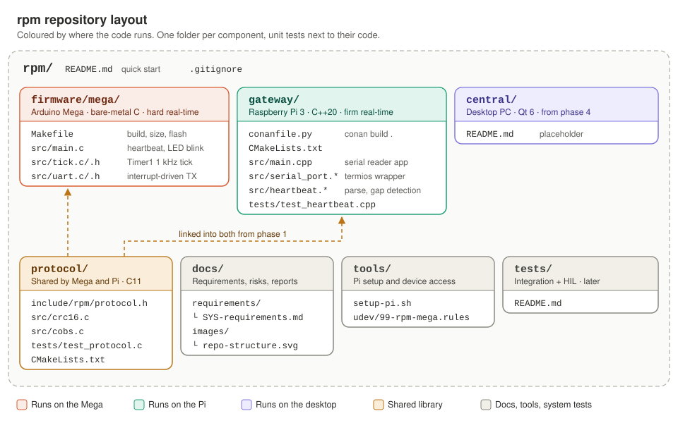

# rpm — Remote Patient Monitoring (learning project)

A three-tier patient monitoring system built on real hardware:

| Tier | Hardware | Role | Real-time class |
|---|---|---|---|
| `firmware/mega` | Arduino Mega 2560 | Patient simulator, bedside panel, valve + watchdog | hard |
| `gateway` | Raspberry Pi 3 | Ingest, analysis, alarm engine, LAN server | firm |
| `central` | Desktop PC | Qt central station | soft |
| `protocol` | shared | Mega <-> Pi packet library (C) | — |

> **New here?** Start with [docs/GETTING_STARTED.md](docs/GETTING_STARTED.md): what to build,
> on which machine, step by step, with or without the hardware.
>
> **Code documentation:** run `doxygen` in this folder and open `build-docs/html/index.html`
> (see section 6 of the guide).

> **Safety:** learning system, not a medical device. Nothing attached to a body
> is ever connected to the mains-powered Mega or Pi.

Full design (architecture, protocol, alarm engine, phase plan, wiring):
see the project documentation doc.

## Repository layout



```
rpm/
  docs/            requirements, risk analysis, test reports
  protocol/        shared C packet library (COBS, CRC-16, message types)
  firmware/mega/   bare-metal AVR firmware for the Mega
  gateway/         Pi gateway (C++20, CMake, Conan 2)
  central/         desktop Qt central station (phase 4)
  tools/           udev rule, scripts
  tests/           integration and hardware-in-the-loop tests (later phases)
```

## Phase 0 quick start

### 1. Set up the Pi (once)

```bash
git clone <your-remote>/rpm.git && cd rpm
./tools/setup-pi.sh          # packages, Conan, dialout group, udev rule
# log out and back in so the dialout group applies
```

### 2. Flash the Mega (from the Pi, over the same USB cable)

```bash
cd firmware/mega
make                         # builds build/rpm_mega.hex
make flash PORT=/dev/mega    # or /dev/ttyACM0 if the udev rule is not installed
```

The on-board LED (D13) blinks at 1 Hz and the Mega prints a heartbeat line
every 100 ms:

```
HB seq=42 uptime_ms=4200
```

### 3. Build and run the gateway on the Pi

```bash
cd gateway
conan build .                # Release, tests off (plain build must always work)
./build/Release_Linux/rpm_gateway /dev/mega
```

Expected output:

```
[rpm_gateway] opened /dev/mega at 115200 baud
[rpm_gateway] waiting for the first heartbeat (the Mega resets when the port opens)
[    1.512 s] HB seq=0 uptime_ms=0
[    1.612 s] HB seq=1 uptime_ms=100
...
```

The gateway warns if a sequence number is skipped, so a one-hour run with no
warnings is a first check of the serial link.

With tests: `conan build . -o "&:with_tests=True"` then `ctest --test-dir build/Release_Linux`.

### 4. Check it from the desktop

```bash
ssh pi@<pi-ip>
picocom -b 115200 /dev/mega      # raw view, Ctrl-A Ctrl-X to quit
```

### Protocol library tests (any Linux host, also WSL)

```bash
cmake -S protocol -B build/protocol -DRPM_PROTOCOL_TESTS=ON
cmake --build build/protocol && ctest --test-dir build/protocol --output-on-failure
```
