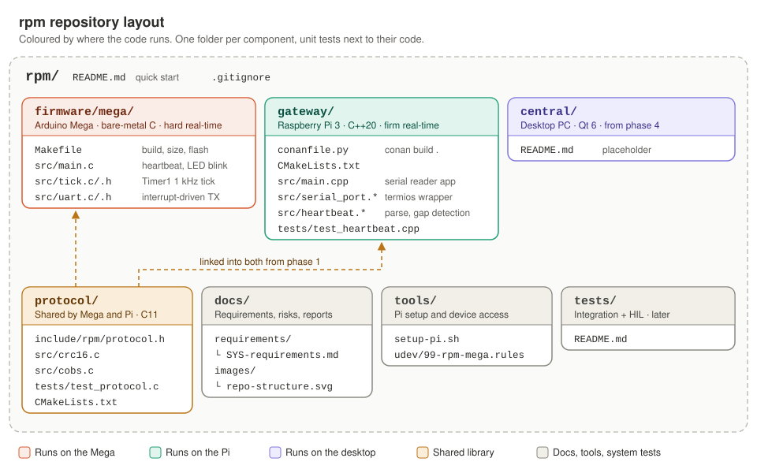
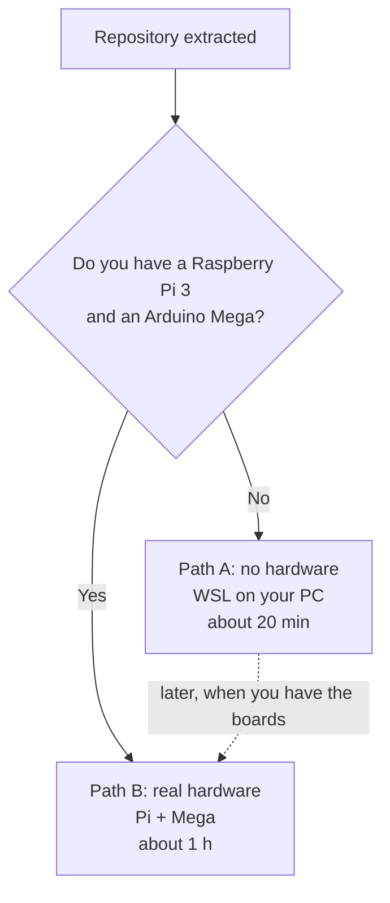

# Getting started

You have just downloaded or cloned this repository and are looking at its top
folder. This guide tells you what is here, what you can build on your machine,
and how to build and run it step by step, with the output you should expect.

**Time:** about 20 minutes without hardware (Path A), about 1 hour with a
Raspberry Pi and an Arduino Mega (Path B).

> **Safety:** this is a learning project, not a medical device. Never connect
> anything attached to a person to the mains-powered Pi or Mega.

## 1. What is in this repository



The project has three programs, one per machine, plus a library they share:

| Folder | What it is | Runs on | Built with | Builds on Windows? |
|---|---|---|---|---|
| `firmware/mega/` | Firmware: simulator and bedside panel | Arduino Mega 2560 | `make` + avr-gcc | Through WSL |
| `gateway/` | Gateway: reads the Mega, analyses, raises alarms | Raspberry Pi 3 | Conan 2 + CMake, C++20 | Yes: MSVC or MinGW, or WSL |
| `protocol/` | Packet library: CRC-16, COBS framing | Mega and Pi | CMake, C11 | Through WSL |
| `central/` | Desktop central station (Qt) | Desktop PC | coming in phase 4 | — |
| `tools/` | Pi setup script, udev rule, fake Mega | — | — | — |
| `docs/` | Requirements, this guide, images | — | — | — |
| `tests/` | System tests across components | — | coming in phase 1 | — |

**Current state (phase 0):** the Mega sends a text heartbeat every 100 ms, and
the gateway prints each one and warns when one is lost, repeated or late.

**On Windows, use WSL** (Windows Subsystem for Linux) for the full workflow:
the firmware needs the AVR compiler, the protocol tests use Linux-only
sanitizers, and the fake Mega needs Linux pseudo-terminals. WSL gives you an
Ubuntu terminal on your PC that sees your Windows files. The gateway alone also
builds natively on Windows (step 3.8), for example to read a Mega plugged into
your PC.

## 2. Pick your path



Path A is a good warm-up even if you own the hardware: it proves the code
builds and shows you what correct output looks like.

## 3. Path A: no hardware (Windows + WSL)

You will build everything, run all unit tests, and watch the gateway read a
simulated Mega.

### 3.1 Install WSL (once)

Open **PowerShell as administrator** and run:

```powershell
wsl --install -d Ubuntu
```

Restart when asked, then open **Ubuntu** from the Start menu and pick a
username and password. Every command from here on runs in that Ubuntu terminal.

### 3.2 Go to the repository

WSL sees your C: drive under `/mnt/c`. Use the folder where you extracted the
repository, for example:

```bash
cd /mnt/c/Users/<your-name>/Desktop/projects/RemotePatientMonitor
ls
```

You should see `central  docs  firmware  gateway  protocol  README.md  tests  tools`.

> Builds under `/mnt/c` work but are slow. For faster builds, copy the folder
> into Linux first: `cp -r . ~/RemotePatientMonitor && cd ~/RemotePatientMonitor`

### 3.3 Install the build tools (once)

```bash
sudo apt update
sudo apt install -y build-essential cmake pipx gcc-avr avr-libc
pipx ensurepath && source ~/.bashrc
pipx install conan
conan profile detect
sed -i 's/^compiler.cppstd=.*/compiler.cppstd=20/' "$(conan profile path default)"
```

The last line sets C++20 in your Conan profile, which the gateway needs.

### 3.4 Build and test the protocol library

```bash
cmake -S protocol -B build/protocol -DRPM_PROTOCOL_TESTS=ON
cmake --build build/protocol
ctest --test-dir build/protocol --output-on-failure
```

Expected last lines:

```
100% tests passed, 0 tests failed out of 1
```

### 3.5 Build and test the gateway

Run this in the **Ubuntu (WSL) terminal**. (For a native Windows build, see
step 3.8.)

```bash
cd gateway
conan build . -o "&:with_tests=True"
```

Expected near the end:

```
100% tests passed, 0 tests failed out of 1
```

The program is now at `gateway/build/Release_Linux/rpm_gateway`.
A plain `conan build .` (no options) builds it without tests.

### 3.6 Run the gateway against a fake Mega

Open a **second Ubuntu terminal**, go to the repository, and start the fake
Mega. It sends the same heartbeat lines as the real firmware:

```bash
python3 tools/fake_mega.py
```

```
fake Mega on /tmp/fake-mega -> /dev/pts/3  (Ctrl-C to stop)
```

In the **first terminal** (still in `gateway/`):

```bash
./build/Release_Linux/rpm_gateway /tmp/fake-mega
```

Expected, ten lines per second:

```
[rpm_gateway] opened /tmp/fake-mega at 115200 baud
[rpm_gateway] waiting for the first heartbeat (the Mega resets when the port opens)
[    0.101 s] HB seq=12 uptime_ms=1203 drop=0
[    0.201 s] HB seq=13 uptime_ms=1303 drop=0
```

Press **Ctrl-C** to stop. The gateway prints a summary:

```
[rpm_gateway] summary after 5.3 s: received=53 lost=0 resets=0
```

**Try the failure cases** to see the gateway's checks work:

| Do this in the fake Mega's terminal | The gateway should print |
|---|---|
| Press **Ctrl-Z** (pauses the fake Mega) and wait 2 s | `WARNING: no heartbeat for 1001 ms (link lost)` |
| Type `fg` and press Enter (resumes it) | `link restored`, then heartbeats again |
| Press **Ctrl-C** (stops it, like unplugging the USB cable) | `error: /tmp/fake-mega: device disconnected`, and the gateway exits |
| Start it with `python3 tools/fake_mega.py --lose-every 20`, then start the gateway again | `WARNING: 1 heartbeat(s) lost before seq=...` every 2 s |

### 3.7 Compile the Mega firmware

You cannot run it without a Mega, but you can check that it builds:

```bash
cd ../firmware/mega
make
```

Expected at the end (sizes vary a little with the compiler version):

```
   text    data     bss     dec     hex filename
   1378       0     264    1642     66a build/rpm_mega.elf
```

Path A is done. Everything compiles, all tests pass, and you have seen the
gateway working.

### 3.8 Optional: build the gateway natively on Windows

Useful when you want the Mega plugged straight into your PC instead of the Pi.
You need Python, Conan 2 (`pip install conan`) and either **Visual Studio 2022**
with the "Desktop development with C++" workload, or **MSYS2 MinGW** GCC.

Once, set C++20 in your Conan profile:

```powershell
conan profile detect
notepad "$(conan profile path default)"     # change compiler.cppstd to 20
```

Then, in PowerShell, from the repository folder:

```powershell
cd gateway
conan build .
```

| Compiler | Program |
|---|---|
| Visual Studio (MSVC) | `gateway\build\Windows\Release\rpm_gateway.exe` |
| MSYS2 MinGW | `gateway\build\Release_Mingw\rpm_gateway.exe` |

To run it, plug the Mega into the PC and find its port in **Device Manager >
Ports (COM & LPT)**, for example `Arduino Mega 2560 (COM3)`:

```powershell
.\build\Windows\Release\rpm_gateway.exe COM3
```

The output is the same as on Linux. Close the Arduino IDE's serial monitor
first: only one program can hold a COM port. The Mega needs the rpm firmware
on it (step 4.5); the simplest way is to flash it from the Pi or from WSL, then
move the cable to the PC. The fake Mega (step 3.6) runs in WSL only.

## 4. Path B: real hardware (Raspberry Pi 3 + Arduino Mega)

### 4.1 What you need

| Item | Notes |
|---|---|
| Raspberry Pi 3 + power supply + microSD card (8 GB or more) | The bedside gateway |
| Arduino Mega 2560 | The patient simulator |
| USB A-B cable ("printer cable") | Connects the Mega to the Pi: data and power |
| Network for the Pi | Ethernet preferred; Wi-Fi works |

Phase 0 needs nothing else: no LEDs, buttons or breadboard yet. For later
phases, see the wiring section in the project documentation (`Docs.pdf`).

```
Desktop PC ── network ── Raspberry Pi 3 ── USB A-B cable ── Arduino Mega
```

### 4.2 Prepare the Pi (once)

1. Install **Raspberry Pi Imager** on your PC. Write **Raspberry Pi OS Lite
   (64-bit)** to the microSD card. In the Imager settings, set a username and
   password, enable **SSH**, and enter your Wi-Fi if you use it.
2. Put the card in the Pi, connect the network and power it up.
3. From your PC (PowerShell or the WSL terminal), log in:

   ```bash
   ssh <user>@raspberrypi.local
   ```

   If the name is not found, look up the Pi's IP address in your router and
   use `ssh <user>@<ip>`.

### 4.3 Put the repository on the Pi

Either clone it, if it is on a git server:

```bash
git clone <repository-url> RemotePatientMonitor
```

or copy it from your PC (run this on the PC, not on the Pi):

```bash
scp -r C:\Users\<your-name>\Desktop\projects\RemotePatientMonitor <user>@raspberrypi.local:~/
```

### 4.4 Install the tools on the Pi (once)

On the Pi:

```bash
cd ~/RemotePatientMonitor
chmod +x tools/setup-pi.sh
./tools/setup-pi.sh
```

This installs the compilers, avrdude, picocom and Conan, sets C++20 in the
Conan profile, adds you to the `dialout` group (serial port access) and
installs a rule that names the Mega `/dev/mega`.

**Log out and log back in** (`exit`, then `ssh` again) so the group change
takes effect.

### 4.5 Connect and flash the Mega

Plug the Mega into the Pi with the USB cable, then:

```bash
ls -l /dev/mega            # should point to ttyACM0 (or similar)
cd ~/RemotePatientMonitor/firmware/mega
make flash
```

Expected at the end:

```
avrdude: 1378 bytes of flash verified
avrdude done.  Thank you.
```

The byte count depends on the compiler version; "verified" is what matters.

The Mega's on-board LED (next to pin 13, marked **L**) now blinks once per second.

### 4.6 Build and run the gateway

```bash
cd ~/RemotePatientMonitor/gateway
conan build .
./build/Release_Linux/rpm_gateway
```

The default port is `/dev/mega`. Expected:

```
[rpm_gateway] opened /dev/mega at 115200 baud
[rpm_gateway] waiting for the first heartbeat (the Mega resets when the port opens)
[    1.612 s] HB seq=0 uptime_ms=0 drop=0
[    1.712 s] HB seq=1 uptime_ms=100 drop=0
```

`seq=0` at the start is normal: opening the port restarts the Mega.

### 4.7 Phase 0 check

Let the gateway run for **one hour**, then press Ctrl-C. The phase 0 gate is
passed when the summary shows `lost=0 resets=0`:

```
[rpm_gateway] summary after 3600.2 s: received=36000 lost=0 resets=0
```

To watch the raw serial data instead, stop the gateway and run
`picocom -b 115200 /dev/mega` (quit with Ctrl-A, then Ctrl-X).

## 5. Troubleshooting

| Symptom | Likely cause | Fix |
|---|---|---|
| `/dev/mega` does not exist | Clone board with a CH340 USB chip, or the udev rule is missing | Use `/dev/ttyACM0` or `/dev/ttyUSB0` directly; for clones, uncomment the CH340 line in `tools/udev/99-rpm-mega.rules` and run `setup-pi.sh` again |
| `Permission denied` opening the port | The `dialout` group change has not applied yet | Log out and back in; check with `groups` |
| `avrdude: stk500v2_ReceiveMessage(): timeout` | Another program holds the port, or the wrong port | Close the gateway and picocom first; check `make flash PORT=/dev/ttyACM0` |
| Gateway opens the port but prints no heartbeats | Firmware not flashed, or a different sketch is on the Mega | Run `make flash` again; the LED must blink at 1 Hz |
| `cl : command line error D8021: invalid numeric argument '/Wextra'` | An older copy of `gateway/CMakeLists.txt` | Update to the current version, delete the `gateway/build` folder, build again |
| Windows: `open COM3: Access is denied` | Another program (Arduino IDE serial monitor, PuTTY) holds the port | Close it and run the gateway again |
| Windows: `open COM3: The system cannot find the file specified` | Wrong COM number | Check Device Manager > Ports (COM & LPT) |
| `conan: command not found` | pipx path not loaded | Run `pipx ensurepath`, then open a new terminal |
| Conan warns that `CMAKE_CXX_STANDARD` changed from 17 to 20 | Profile still on C++17 | Run the `sed` line from step 3.3 |
| `make: avr-gcc: No such file or directory` | AVR compiler not installed | `sudo apt install gcc-avr avr-libc` |
| Builds in WSL are very slow | Building on the Windows drive (`/mnt/c`) | Copy the repository into your Linux home folder (step 3.2) |

## 6. Browse the code as a website (Doxygen)

Doxygen turns the code and its comments into an HTML site: every file, class
and function with its description, call and include graphs, the highlighted
source, and a search box. It runs on Windows, WSL, Linux and the Pi.

### 6.1 Install Doxygen and Graphviz (once)

Graphviz draws the graphs; without it you get the site without graphs.

| System | Command |
|---|---|
| Windows (PowerShell) | `winget install DimitriVanHeesch.Doxygen` and `winget install Graphviz.Graphviz` |
| Ubuntu, WSL, Raspberry Pi OS | `sudo apt install -y doxygen graphviz` |

On Windows, open a new terminal afterwards and check with `doxygen --version`
and `dot -V`. If `dot` is not found, add `C:\Program Files\Graphviz\bin` to your PATH.

### 6.2 Generate the site

In the repository root:

```bash
doxygen
```

Or through CMake, for example from Visual Studio's "Open Folder":

```bash
cmake -S docs -B build-docs/cmake
cmake --build build-docs/cmake
```

Open **`build-docs/html/index.html`** in a browser. What you find there:

| Where | What |
|---|---|
| Main Page | This repository's README |
| Related Pages | This guide |
| Namespaces, Classes, Files | Every function, class and file, each with its one-line summary |
| A function's page | Description, example, parameters with `[in]`/`[out]`, return value, call and caller graphs |
| A file's page | Include graphs and the highlighted source |

`build-docs/` is a build output: do not commit it.

### 6.3 Documentation standard

Every function gets a Doxygen comment in this form, on its declaration in the
header (or on the definition, for helpers that exist only in a `.cpp` file):

```cpp
/**
 * @brief <What the function does, in one line.>
 *
 * <Optional: one line on anything the brief does not make clear.>
 *
 * @par Example
 * @code
 * <One or two lines: a call and its result.>
 * @endcode
 *
 * @param[in]     <name>  <One line. [in]: only read.>
 * @param[out]    <name>  <One line. [out]: only written.>
 * @param[in,out] <name>  <One line. [in,out]: read and written.>
 * @return <What the return value means, in one line.>
 */
```

A complete example is `take_field()` in `gateway/src/heartbeat.cpp`.

Helpers used by only one `.cpp` file go in `namespace rpm::detail`, not in an
anonymous namespace: Doxygen gets the call graphs of anonymous-namespace
functions wrong.

## 7. Where to go next

- `Docs.pdf`: the full project documentation: architecture, protocol, alarm
  engine, wiring and circuit diagrams, and the phase plan.
- `docs/requirements/SYS-requirements.md`: what the system must do; every test
  refers back to these IDs.
- `README.md`: the short version of this guide.
- `build-docs/html/index.html`: the generated code documentation (section 6).

Phase 1 replaces the text heartbeat with binary frames from `protocol/` and
adds the patient simulator scenarios.
